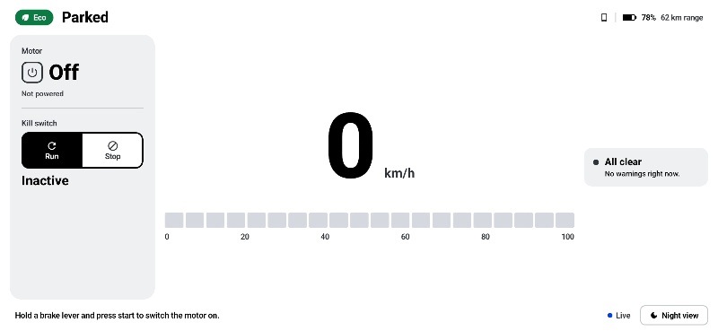
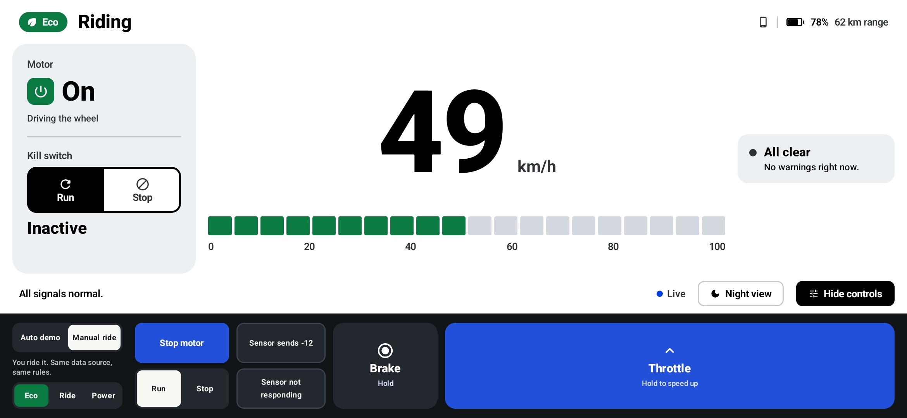
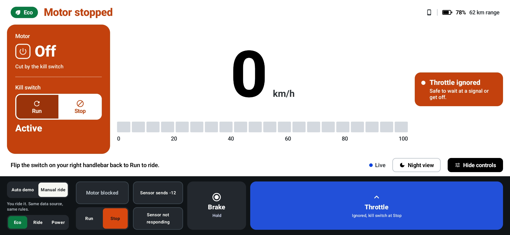
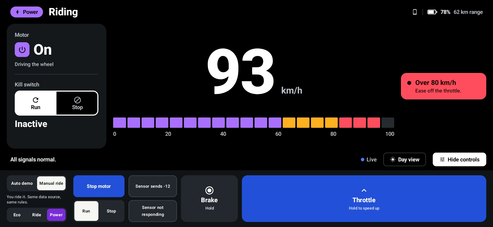

# Ultra Cluster

A landscape ride dashboard for an electric scooter, built with Jetpack Compose. It shows speed, motor status and kill switch status, and updates by itself from a simulated vehicle.



| Riding in Eco (day) | Kill switch at Stop (day) | Overspeed in Power (night) |
| --- | --- | --- |
|  |  |  |

The dark bar at the bottom of the screenshots is a built-in simulator. It stands in for the scooter itself: start the motor, flip the kill switch, hold the throttle or brake, switch ride modes, or inject sensor faults.

## Why it looks like this

I ride a scooter with a digital cluster every day, and in Bengaluru sunlight it's often hard to read. So the day theme is plain black on white with heavy fonts, which is the most readable a phone screen gets in the sun. Night mode is true black.

The speed is a straight bar instead of a round gauge because it's quicker to read at a glance. It turns amber above 60 and red above 80.

The kill switch is drawn like the real Run / Stop switch on the handlebar. When it's at Stop, the left panel turns orange and the title says "Motor stopped". Turning the motor off doesn't force the speed to 0, so if you cut it while moving, the screen shows you're coasting.

Ride modes (Eco, Ride, Power) have their own colours, and orange and red are kept for warnings. The idle auto-off hint comes from my petrol scooter, which cuts the engine after sitting idle.

## Build and run

Open in Android Studio and run on a device or emulator in landscape (min SDK 26). The layout scales to fit phones and tablets.

```
./gradlew installDebug
```

## Try it

The control bar at the bottom is open on launch; **Hide controls** shows the full cluster.

- **Auto demo:** press Play to cycle Parked, Ready, Riding (25), Accelerating (50) and Motor disabled, one reading per second.
- **Fault buttons:** invalid speed (−12), sensor goes silent, kill switch while moving, overspeed.
- **Manual ride:** start the motor, hold Throttle, let go to coast, hold Brake, flip Run / Stop.

## How it works

Simulated vehicle → ViewModel → Compose UI. Buttons send events back through the ViewModel to the simulator, so faults go through the same handling as real readings.

- `SimulatedVehicleDataSource` emits a reading every tick from a coroutine `flow`.
- `DashboardMapper` turns a reading into what the screen shows. All the rules are in this one place.
- `DashboardViewModel` exposes one `StateFlow`. If no reading arrives for 3 s it shows a "sensor not responding" state, and a crash in the data source shows an error state instead of crashing the app.
- The composables are stateless. They only read the state and send events.

Bad data is handled without crashing: an invalid speed shows `--`, a missing reading shows "Unknown", and stale data hides the values.

## Tests

```
./gradlew testDebugUnitTest
```

Unit tests cover the mapper rules: a normal riding reading, a negative speed being rejected without hiding the other signals, and the kill switch at speed keeping the real speed.

## Assumptions

- Speed bar is 0–100 km/h; above 120 counts as invalid.
- Data is stale after 3 s without a reading.
- Each auto scenario shows for two readings so it's readable.
- Manual mode updates every 200 ms for smooth control.
- Battery and ride range are display only.

